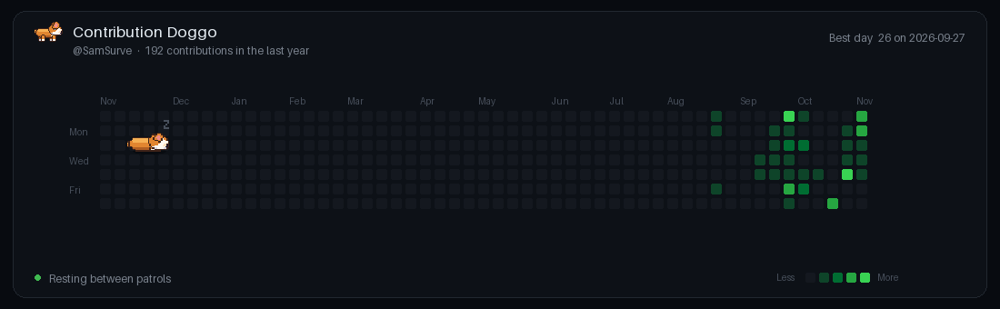

# 🐕 Contribution Doggo

[](https://github.com/SamSurve/contribution-doggo/actions/workflows/generate-doggo.yml)

A premium animated pixel-art corgi companion that physically lives inside your GitHub contribution calendar.



## Features

- 🐾 **Lives in the Grid**: The corgi trots directly across the 53×7 contribution squares, with paws aligned to the calendar rows.
- 🔍 **Intelligent Sniffing**: Dynamically discovers active contribution squares, approaches them, and sniffs with animated scent sparkles.
- 🐾 **Pawprints**: Leaves tiny glowing pawprints on visited contribution cells.
- 🎨 **Original Pixel Art**: Bespoke 32×22 corgi character with multi-frame running, idle breathing, head tilt, paw touch, and tail wag animations.
- ⚡ **Dynamic & Future-Proof**: Automatically updates daily via GitHub Actions. New commits tomorrow appear on the next scheduled regeneration.
- 🌙 **GitHub Dark Theme**: Styled to match GitHub's dark canvas (`#0d1117`), authentic contribution greens, month headers, weekday labels, and a live status ticker.

## How It Works

1. Fetches real contribution data from the GitHub GraphQL API (with public web endpoint fallback).
2. Dynamically calculates coordinates and selects diverse targets across time and rows.
3. Plans an exploratory path with a full state machine (`IDLE` → `RUN` → `LOOK_AROUND` → `APPROACH` → `SNIFF` → `PAW_TOUCH` → `STAMP` → `CELEBRATE` → `LOOP`).
4. Renders an optimized animated GIF with smooth frame timing and compact file size.
5. GitHub Actions runs daily and publishes the latest GIF to the `output` branch.

## Known Limitations

- **GraphQL 100-Repository Coverage**: GitHub's GraphQL `commitContributionsByRepository` API query scans up to 100 repositories containing commit contributions over the past year (`maxRepositories: 100`), with full pagination across their commit connections. For users whose commits span more than 100 repositories within a single year, commit tracking aggregates the top 100 repositories returned by GitHub's GraphQL API.
- **Unauthenticated Local Development**: Without a GitHub personal access token (`DOGGO_TOKEN`), local runs use public HTML scraping (`fetch_contributions_web`). In this unauthenticated fallback, full contribution squares are rendered for the visual calendar, but commit-specific tracking is marked unavailable (`commit_count = None`) to prevent false commit alerts, and snapshot baseline advancement is safely skipped.

## Local Development

```bash
# Install dependencies
pip install -r requirements.txt

# Run tests
pytest tests

# Generate Doggo animation
python doggo.py
```

Output is saved to `dist/contribution-doggo.gif`.
