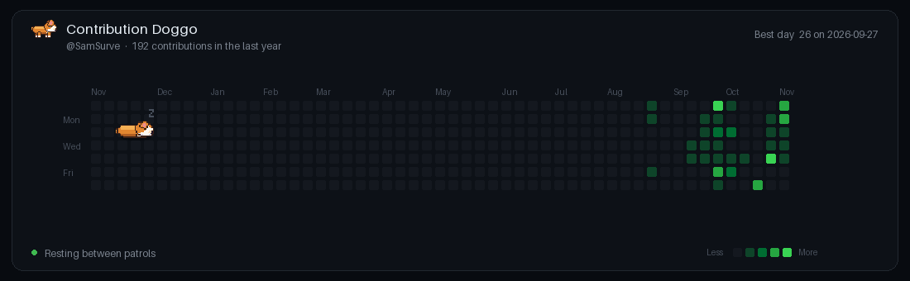

# Add Doggo to your profile

After the workflow succeeds once, add this block to `SamSurve/SamSurve/README.md` exactly where you want Doggo to appear:

```html
<div align="center">



</div>
```

The image URL points to the generated GIF on this repository's `output` branch. Keep the rest of your profile README unchanged.

## Required secret

In `SamSurve/contribution-doggo`, open **Settings → Secrets and variables → Actions → New repository secret**.

- Name: `DOGGO_TOKEN`
- Value: a fine-grained personal access token for `SamSurve` with access to read your profile's contribution calendar through GitHub GraphQL. Never commit the token.

The workflow uses the repository's built-in `GITHUB_TOKEN` to publish the finished GIF to the `output` branch. In **Settings → Actions → General → Workflow permissions**, enable **Read and write permissions**.

## Run

Go to **Actions → Generate Contribution Doggo → Run workflow**. The workflow fetches your contribution calendar and generates `contribution-doggo.gif`.

The GIF is a snapshot refreshed daily, not a live animation connected to GitHub while the README is open.
